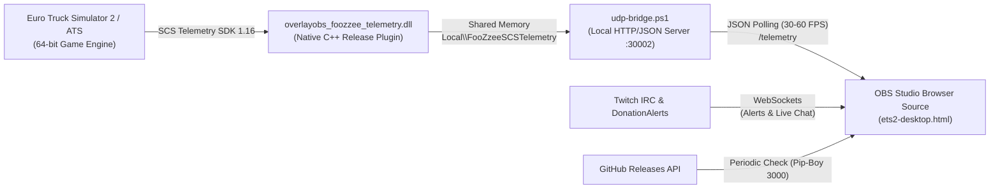

# 🚛 Cockpit Telemetry Stream Overlay for ETS2 & ATS

> **Professional broadcast cockpit HUD for OBS Studio powered by native SCS Telemetry SDK 1.16**

[](https://github.com/FooZzee/ets2-ats-stream-overlay/releases)
[](https://www.microsoft.com/windows)
[](https://modding.scssoft.com/wiki/Documentation/Tools/Telemetry_server)
[](https://scssoft.com/)
[](https://obsproject.com/)
[](./LICENSE)

[](https://www.donationalerts.com/r/foozzee)

---

> **Navigation:** **English** | [Русский](./README.ru.md) | [Bilingual Combined README](./README.md) | [Changelog](./CHANGELOG.md) | [Commands Reference](./commands.en.md)

---

## 📌 Table of Contents

1. [Overview & Key Features](#-overview--key-features)
2. [What's New in v1.2.0](#-whats-new-in-v120)
3. [Architecture & Components](#-architecture--components)
4. [HUD Layout & Elements](#-hud-layout--elements)
5. [System Requirements](#-system-requirements)
6. [1-Click GUI Installation](#-1-click-gui-installation)
7. [Manual Configuration & Parameters](#-manual-configuration--parameters)
8. [OBS Studio Scene Configuration](#-obs-studio-scene-configuration)
9. [Troubleshooting Matrix](#-troubleshooting-matrix)
10. [Author & Community](#-author--community)

---

## 💎 Overview & Key Features

**ETS2 / ATS Cockpit Telemetry Stream Overlay** is an ultra-low latency, broadcast-grade telemetry HUD designed specifically for live streamers on Twitch, YouTube, and TikTok. Built around realistic amber/ice cockpit ergonomics, it provides comprehensive driving, vehicle, and trip telemetry while keeping the driver's windshield, mirrors, and in-game GPS completely unobstructed.

* ⚡ **Zero-Overhead Shared Memory:** Bundles a custom C++ plugin (`overlayobs_foozzee_telemetry.dll`) that interfaces directly with SCS Telemetry SDK 1.16 via Win32 Shared Memory. Zero external proxy tools, third-party executables, or heavy Node runtimes required.
* 🖥️ **2-Row Lower Dashboard ("Torpedo"):** Occupies the lower edge of a `1920×1080` canvas, offering pristine visibility for natural simulation viewing.
* 🖥️ **Full HD Desktop Cockpit HUD:** 2-row broadcast HUD (`1920×1080`) for OBS Studio with transparent windscreen area and solid dashboard base.
* ⏱️ **Real-World Navigation ETA (`real-eta-panel`):** Automatically detects the active map scale (`1:19` highways, `1:3` cities, `1:10` UK) to convert in-game navigation time into precise real-world hours and minutes remaining.
* 💬 **Audience Engagement:** Integrated Twitch IRC chat client and sequential FIFO alert notifications (`donate`, `sub`, `follow`, `raid`) with optional DonationAlerts integration.
* 🌐 **Instant Bilingual Support:** Seamless English and Russian localization (`EN` / `RU`) across the entire HUD, installer, and update terminal.

---

## 🚀 What's New in v1.2.0

> [!IMPORTANT]
> **Release v1.2.0** introduces in-game telemetry event popups positioned at the upper windscreen area (`top: 14%`), 100% bilingual badge localization, procedural Web Audio API sound synthesizer, smart stream session statistics, and Twitch chat interactive viewer commands (`!honk`, `!cb`, `!route`, `!stats`, `!truck`, `!driver`, `!bet`).

* 🔔 **Windscreen In-Game Toast Notifications (`.telemetry-event-toast`):**
  * Positioned at the top windscreen clear zone (`top: 14%; left: 50%`) with opaque cockpit background (`#0e131b`), accent glow borders, 4.5s holding duration, and sequential FIFO queue.
  * 100% localized badge tags (`FINE`, `TOLL`, `FUEL`, `FERRY`, `TRAIN`, `CONTRACT`, `CANCEL`, `CARGO`, `SERVICE`, `RESERVE`, `COACH`, `COMFORT`, `HORN`, `CB RADIO`, `STATS`, `WINNERS`).
* ⚡ **Full SCS SDK Gameplay Event Interception:**
  * Real-time capture of traffic fines, tollgates, maritime ferries, rail transits, cargo deliveries, and contract cancellations.
  * Comprehensive dictionary for rare SCS SDK offences: `illegal_trailer`, `damaged_vehicle`, `illegal_border_crossing`, `hard_shoulder_violation`, `generic` with unique multi-color SVG vector icons and synthesized audio.
* 🛠️ **Telemetry & Fleet Detectors:**
  * Automated real-time alerts for cargo/chassis damage, service station overhaul complete, low fuel reserve warning, and DLC Coaches passenger comfort drops.
* 💬 **Twitch Chat Interactive Commands (`ets2-chat.js`):**
  * Role-based viewer interactions: `!honk`, `!cb <text>`, `!route`, `!stats`, `!truck`, `!driver`, and job outcome bets (`!bet clean` / `!bet fine`). See [Commands Reference](./commands.en.md).

* 🗺️ **Primary HUD Route & Trip Display:**
  * Active cargo name and tonnage or passenger coach route now render directly inside the primary dashboard module (`#route-value` and `#lt-cargo`).
  * Live passenger comfort satisfaction rating (**`SATISFACTION: XX%`**) for ETS2 DLC Coaches displayed in the central cluster.
* 🌐 **100% Strict Bilingual Separation (EN / RU):**
  * Complete linguistic purity: zero Cyrillic tokens leak into English mode, and zero raw Latin tokens leak into Russian mode regardless of game client language.
  * Comprehensive `CITIES_DB` dictionary with reverse lookup and phonetic transliteration fallback for mod maps and rare DLC cities.
* ⚡ **Telemetry Bridge Parsing Fix (`scripts/udp-bridge.ps1`):**
  * Resolved a PowerShell syntax evaluation error (`CommandNotFoundException`) inside `Clean-PlaceName` that previously triggered false `offline` telemetry states.
* 🛡️ **Shared Memory Security Architecture (`Local\FooZzeeSCSTelemetry`):**
  * Configured an explicit Win32 `SECURITY_DESCRIPTOR` with `NULL DACL` in `native-plugin/plugin.cpp`, preventing `ERROR_ACCESS_DENIED` (Win32 Error 5) when ETS2 or Steam runs with elevated Administrator privileges.
* 🔄 **Native Plugin Renaming & Hardening:**
  * Renamed the native telemetry plugin to `overlayobs_foozzee_telemetry.dll` across source code, build scripts, installers, and runtime scripts to avoid file naming collisions with other tools.
  * Disabled legacy file-based debug logging (`scs_sdk_dump.log`) to eliminate disk I/O overhead.
* 🧹 **Automated Legacy File Cleanup:**
  * Updated `scripts/installer.ps1` and `build-and-install-plugin.bat` to automatically remove obsolete `scs_direct_telemetry.dll` from game directories while preserving third-party plugins.
* 📟 **Pip-Boy 3000 Standalone Auto-Update Terminal:**
  * Autonomous update checking (`assets/js/ets2-updater.js`) against the official GitHub API (`releases/latest`) without disrupting stream operations.
  * Retro CRT aesthetics: authentic green phosphor glow (`#00ff66`), scanlines, tube glass vignetting, and cathode-ray power-on/off animations.
  * Built-in WebAudio retro synthesizer: procedural typewriter key clicks during text generation and high-voltage capacitor discharge hum on shutdown.
  * Interactive control buttons: **`[ 🚀 UPDATE NOW ]`** and **`[ 💤 NEVERMIND ]`**.
* 💖 **«SUPPORT PROJECT» Button in Installer:**
  * Interactive button added to `Install-Overlay.bat` (`scripts/installer.ps1`), linking directly to the author's DonationAlerts page: `https://www.donationalerts.com/r/foozzee`.
* 🚌 **Full Euro Truck Simulator 2 — DLC Coaches Support:**
  * Native recognition of coach passenger trips (`bus_job`) with 100% backwards compatibility for standard freight cargo hauling in ETS2 & ATS.
  * Automatic stop-to-stop route parsing (`source_stop.*` ➔ `destination_stop.*`).
  * Real-time passenger satisfaction rating: **`SATISFACTION: XX%`** displayed in the onboard computer ticker.
* ⚡ **New Native SCS Telemetry SDK Channels:**
  * `bus_job.average_satisfaction` (`FLOAT`) — average passenger comfort rating.
  * `rest.stop` (`S32`) — fatigue and mandatory rest countdown timer in minutes.
  * `truck.electric.enabled` (`BOOL`) — onboard electrical system & ignition status.
  * `truck.engine.enabled` (`BOOL`) — engine running state.
* 🎛️ **100% Solid Opacity Lower Cockpit HUD:**
  * Dashboard background in `ets2-desktop.html` set to 100% solid opacity (`alpha = 1`). Asphalt textures, road markings, and headlights no longer bleed through the speedometer and indicators in OBS Studio.
* 💳 **DonationAlerts Wizard Setup:**
  * Added a password-masked DonationAlerts secret token field in the GUI installer (`Install-Overlay.bat`) with a **Show / Hide** toggle.

---

## 🏛️ Architecture & Components



| Component | Responsibility | Technology Stack |
|---|---|---|
| `overlayobs_foozzee_telemetry.dll` | In-process telemetry hook & serialization | C++20, SCS Telemetry SDK 1.16, Win32 Shared Memory |
| `scripts/udp-bridge.ps1` | Ultra-fast local HTTP bridge server (`:30002`) | PowerShell 5.1+, `HttpListener`, JSON |
| `assets/js/ets2-updater.js` | Standalone Pip-Boy 3000 update detector | ES6 JavaScript, WebAudio API, GitHub REST API |
| `assets/css/ets2-pipboy.css` | Phosphor CRT scanlines, vignette & animations | Pure CSS3, Keyframe Animations, Flexbox |
| `ets2-desktop.html` | 2-row horizontal cockpit HUD (`1920×1080`) | HTML5, CSS Grid, Canvas, Vanilla JS |
| `scripts/installer.ps1` | 1-click GUI setup wizard (`Install-Overlay.bat`) | PowerShell WinForms, UTF-8 with BOM |

---

## 💻 System Requirements

* **OS:** Windows 10 / Windows 11 (64-bit).
* **Environment:** PowerShell 5.1+ (pre-installed on Windows).
* **Game:** Euro Truck Simulator 2 (64-bit) and/or American Truck Simulator (64-bit).
* **Streaming Software:** OBS Studio 28.0+ (*Browser Source*).

---

## ⚡ 1-Click GUI Installation

1. Download the latest release archive **`ETS2-ATS-Stream-Overlay-v1.2.1.zip`** from [Releases](https://github.com/FooZzee/ets2-ats-stream-overlay/releases).
2. Extract the archive into any permanent folder (e.g., `C:\ETS2-ATS-Stream-Overlay`).
3. Run **`Install-Overlay.bat`**:
   * Choose **`English (EN)`** or **`Русский (RU)`** in the top-right corner.
   * The installer auto-detects your Steam game directories.
   * Enter your **Streamer Nickname**, **Twitch Channel**, and optionally your secret **DonationAlerts Token**.
   * Click **`Install`**.
4. The wizard will automatically copy `overlayobs_foozzee_telemetry.dll` into each game's `bin\win_x64\plugins` folder, generate your `config.js`, and create the **`ETS2-ATS Overlay Bridge`** Desktop shortcut.
   * You can also use the **«💖 SUPPORT PROJECT»** button in the installer's footer to support the creator on DonationAlerts.

---

## ⚙️ Manual Configuration & Parameters

To configure the overlay manually:

1. Copy `config.example.js` to `config.js`.
2. Copy `./redist/overlayobs_foozzee_telemetry.dll` into:
   * `.../Euro Truck Simulator 2/bin/win_x64/plugins/overlayobs_foozzee_telemetry.dll`
   * `.../American Truck Simulator/bin/win_x64/plugins/overlayobs_foozzee_telemetry.dll`
3. Edit `config.js`:

```javascript
window.OVERLAY_CONFIG = {
  lang: 'en', // 'en' or 'ru'
  ets2: {
    driverName: 'STREAMER',
    speedUnit: 'kmh'
  },
  channels: {
    twitch: {
      enabled: true,
      channelName: 'your_twitch_channel'
    },
    donationAlerts: {
      enabled: true,
      socketToken: 'YOUR_SECRET_TOKEN' // from DonationAlerts Account Settings -> Secret Token
    }
  },
  theme: {
    cockpitPreset: 'amber' // 'amber' or 'ice'
  }
};
```

### URL Query Overrides for OBS Browser Source:
* `?lang=en` or `?lang=ru` — override language per scene.
* `?theme=ice` or `?theme=amber` — toggle cockpit color theme.
* `?cam=0` — hide webcam frame.
* `?test=1` — interactive test mode with animated gauges, simulated chat, and alerts.
* `?test_update=1` — test the Pip-Boy 3000 update terminal modal.
* `?guides=1` — show HUD alignment guides and safe-zone grid.

---

## 🎥 OBS Studio Scene Configuration

1. **Start the Telemetry Bridge:** Double-click the Desktop shortcut **`ETS2-ATS Overlay Bridge`** (`start-telemetry.bat`). A terminal window will open hosting `http://127.0.0.1:30002/telemetry`.
2. **Add Browser Source in OBS (MUST USE "URL" — UNCHECK "LOCAL FILE"):**
   * In OBS Sources, click **`+`** and choose **Browser Source**.
   * > [!WARNING]
     > **CRITICAL OBS CONFIGURATION:** **UNCHECK the "Local file" (Локальный файл) checkbox!**  
     > The overlay must be added strictly via the **"URL" (Ссылка)** field. If loaded with "Local file" checked, OBS isolates the page in a restricted file sandbox: **interactive cockpit controls, Pip-Boy update buttons, and external links will NOT work**.
   * In the **`URL` (Ссылка)** field, enter the full path to the HTML file:  
     `D:\html\Overlay\ets2-desktop.html` *(or `C:\ETS2-ATS-Stream-Overlay\ets2-desktop.html`)*  
     * **Resolution:** Width **`1920`**, Height **`1080`**, FPS: **`60`** fps.
   * Check: **«Refresh browser when scene becomes active»** & **«Shutdown source when not visible»**.
   * **Interactive Controls:** To click buttons on the HUD (such as Pip-Boy update buttons or social links), right-click the Browser Source in OBS and select **«Interact» (Взаимодействовать)**.
3. **Webcam Positioning (Desktop Scene):**
   * Dimensions: Width **`346 px`**, Height **`195 px`** (`16:9` ratio).
   * Coordinates: X (Left) = **`24 px`**, Y (Top) = **`180 px`**.
   * In the OBS Sources list, order your webcam capture device **below** the Browser Source layer so HUD corner brackets neatly overlap the webcam feed.

---

## 🛠️ Troubleshooting Matrix

| Symptom | Probable Cause | Action |
|---|---|---|
| Speedometer shows `--` and `STANDBY` | Bridge not running or DLL missing | Start `start-telemetry.bat`. Confirm `overlayobs_foozzee_telemetry.dll` is in `bin\win_x64\plugins\`. Visit `http://127.0.0.1:30002/health` in your browser. |
| Game is running but HUD doesn't update | 32-bit game or SDK declined | Run the 64-bit simulator. On initial startup, accept the in-game prompt granting SDK access. In the game main menu, telemetry remains in standby until a profile loads. |
| "Port 30002 already in use" | Duplicate bridge running | Close any extra command prompt window running `start-telemetry.bat`. |
| No donation alerts appearing | Invalid DonationAlerts token | Verify `socketToken` in `config.js` (copy the secret token from *Account Settings -> Secret Token*, not the widget URL). |
| Twitch chat is missing | Incorrect channel name | Ensure `channelName` in `config.js` contains only your username (e.g. `'your_channel'`), without URLs or `@`. |

---

## 👤 Author & Community

* **Creator:** FooZzee
* **Official Website:** [foozzee.ru](https://foozzee.ru/)
* **Twitch:** [twitch.tv/foozzee](https://www.twitch.tv/foozzee)
* **YouTube:** [@foozzee](https://www.youtube.com/@foozzee)
* **Telegram:** [@foozzeestream](https://t.me/foozzeestream)
* **VK:** [vk.ru/gtfun](https://vk.ru/gtfun)

Licensed under the [Proprietary Freeware License (All Rights Reserved)](./LICENSE). Free for streamers, content creators, and modders.

---

Copyright (c) 2026 FooZzee. All Rights Reserved.
