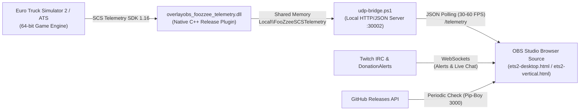

# 🚛 Cockpit Telemetry Stream Overlay for ETS2 & ATS

> **Professional broadcast cockpit HUD for OBS Studio powered by native SCS Telemetry SDK 1.16**  
> **Профессиональный бортовой HUD-оверлей для OBS Studio на базе нативного SCS Telemetry SDK 1.16**

---

### 🌐 Quick Language Jump / Выбор языка

*Standalone files:* [English (README.en.md)](./README.en.md) • [Русский (README.ru.md)](./README.ru.md)

---

## 🇬🇧 English Documentation

**ETS2 / ATS Cockpit Telemetry Stream Overlay** is an ultra-low latency, broadcast-grade telemetry HUD designed specifically for live streamers on Twitch, YouTube, and TikTok. Built around realistic amber/ice cockpit ergonomics, it provides comprehensive driving, vehicle, and trip telemetry while keeping the driver's windshield, mirrors, and in-game GPS completely unobstructed.

### ✨ Key Highlights & v1.1.3 Features
* 🗺️ **Primary HUD Route & Trip Integration:** Active cargo name and tonnage or passenger coach route now render directly inside the primary dashboard module (`#route-value` and `#lt-cargo`), with live passenger comfort rating (**`SATISFACTION: XX%`**).
* 🌐 **100% Strict Bilingual Separation (EN / RU):** Pure English and Russian modes without cross-lingual leakage, powered by the comprehensive `CITIES_DB` geographic dictionary and phonetic transliteration.
* ⚡ **Ultra-Stable Telemetry Bridge & Plugin:** Powered by `overlayobs_foozzee_telemetry.dll` with `NULL DACL` Win32 Shared Memory architecture (`Local\FooZzeeSCSTelemetry`) and fixed high-speed PowerShell HTTP bridge (`:30002`).
* 📟 **Pip-Boy 3000 Auto-Update Terminal:** Autonomous GitHub update checker with authentic green CRT phosphor styling, scanlines, WebAudio procedural typewriter sound effects, CRT shutdown audio, and full EN/RU bilingual support.
* 💖 **Project Support Integration:** One-click «💖 SUPPORT PROJECT» button in the GUI installer linking directly to DonationAlerts.
* 🚌 **Full ETS2 DLC Coaches Support:** Native coach passenger job detection (`bus_job`), stop-to-stop routing (`source_stop.*` ➔ `destination_stop.*`), and live passenger satisfaction rating.
* 🎛️ **100% Solid Opacity Lower Cockpit HUD (`1920×1080` — `ets2-desktop.html`):** Opaque dashboard background eliminates road texture bleed-through in OBS Studio while keeping webcam, chat, and alert popups transparent.
* 📱 **Mobile Vertical Layout (`1080×1920` — `ets2-vertical.html`):** Native layout optimized for TikTok Live, YouTube Shorts, and Reels with UI safe zones.
* ⏱️ **Real-World ETA (`real-eta-panel`):** Automatically detects active map scale (`1:19` highways, `1:3` cities, `1:10` UK) to compute real-world time remaining.
* 💬 **Twitch IRC Chat & FIFO Alerts:** Built-in sequential alert queue (`donate`, `sub`, `follow`, `raid`) with stream-safe DonationAlerts token configuration.
* ⚡ **1-Click GUI Wizard (`Install-Overlay.bat`):** Auto-detects Steam libraries, installs the C++ plugin, cleans legacy files, and creates a Desktop shortcut.

### 🏛️ Architecture Overview

### ⚡ Quick Start
1. Download **`ETS2-ATS-Stream-Overlay-v1.1.3.zip`** from [Releases](https://github.com/FooZzee/ets2-ats-stream-overlay/releases).
2. Extract the archive into any folder (e.g. `C:\ETS2-ATS-Stream-Overlay`).
3. Run **`Install-Overlay.bat`**, enter your Twitch username and DonationAlerts token, and click **Install**.
4. Double-click the **`ETS2-ATS Overlay Bridge`** Desktop shortcut before streaming.
5. In OBS Studio, add a **Browser Source** (1920×1080):
   * > [!WARNING]
     > **CRITICAL OBS SETTING:** **UNCHECK "Local file" (Локальный файл)!** Add the overlay strictly via the **"URL" (Ссылка)** field (`D:\html\Overlay\ets2-desktop.html`). If "Local file" is checked, OBS sandbox restrictions will **break interactive cockpit controls, Pip-Boy update buttons, and external links**.
   * Use OBS **Interact (Взаимодействовать)** to click buttons on the HUD.
   * Support the project anytime via the **«💖 SUPPORT PROJECT»** button in the installer.

### 🎥 OBS Studio Placement
* **Webcam Dimensions:** Width **`346 px`**, Height **`195 px`** (`16:9`).
* **Webcam Coordinates:** Left **`24 px`**, Top **`180 px`** (place capture layer **below** the browser overlay).

---

## 🇷🇺 Русская документация

**Cockpit Telemetry Stream Overlay** — это высокопроизводительный приборный комплекс для стримеров Euro Truck Simulator 2 и American Truck Simulator. Оверлей разработан с акцентом на реалистичность, отсутствие визуального мусора в лобовом стекле и нулевую задержку передачи телеметрии.

### ✨ Ключевые возможности и релиз v1.1.3
* 🗺️ **Интеграция рейса в основной блок HUD:** Реальный перевозимый груз и тоннаж либо маршрут автобуса отображаются напрямую в центральном модуле кабины (`#route-value` и `#lt-cargo`), включая комфорт пассажиров (**`КОМФОРТ: XX%`**).
* 🌐 **100% строгое разделение языков (RU / EN):** Полная изоляция русской и английской локализаций без смешения языков на базе встроенного географического словаря `CITIES_DB` и транслитерации.
* ⚡ **Сверхстабильный мост телеметрии и нативный плагин:** Библиотека `overlayobs_foozzee_telemetry.dll` с архитектурой `NULL DACL` для разделяемой памяти `Local\FooZzeeSCSTelemetry` и исправленным скоростным PowerShell HTTP-мостом (`:30002`).
* 📟 **Автономный терминал обновлений Pip-Boy 3000:** Встроенный модуль проверки релизов на GitHub в аутентичном стиле зелёного кинескопа Fallout со звуками механической печатной машинки, выключением CRT и полной поддержкой русского и английского языков.
* 💖 **Поддержка проекта:** Интерактивная кнопка «💖 ПОДДЕРЖАТЬ ПРОЕКТ» в мастере установки со ссылкой на DonationAlerts автора.
* 🚌 **Полная поддержка ETS2 DLC Coaches:** Нативное распознавание автобусных рейсов (`bus_job`), остановок отправления и назначения (`source_stop.*` ➔ `destination_stop.*`) и вывод комфорта пассажиров.
* 🎛️ **100% непрозрачный фон приборной панели («торпеды»):** Фон нижней панели в `ets2-desktop.html` сделан полностью непрозрачным (`alpha = 1`), исключая просвечивание текстур асфальта под приборами в OBS Studio.
* 📱 **Вертикальная сцена (`1080×1920` — `ets2-vertical.html`):** Адаптирована под безопасные зоны мобильных стримов TikTok Live, YouTube Shorts, Reels.
* ⏱️ **Реальное время в пути (`real-eta-panel`):** Конвертирует навигационное время симулятора с учётом масштаба карты (`1:19`, `1:3`, `1:10`) в реальные минуты до цели.
* 💬 **Чат Twitch IRC и FIFO-алерты:** Всплывающие карточки оповещений (`donate`, `sub`, `follow`, `raid`) с поддержкой DonationAlerts.
* ⚡ **1-клик графический установщик (`Install-Overlay.bat`):** Автоматический поиск игр в Steam, установка плагина, очистка устаревших файлов, защищённое поле токена DonationAlerts и ярлык на Рабочем столе.

### ⚡ Быстрый старт
1. Скачайте архив **`ETS2-ATS-Stream-Overlay-v1.1.3.zip`** из раздела [Releases](https://github.com/FooZzee/ets2-ats-stream-overlay/releases).
2. Распакуйте архив в удобную папку (например, `C:\ETS2-ATS-Stream-Overlay`).
3. Запустите **`Install-Overlay.bat`**, введите никнейм Twitch и токен DonationAlerts, затем нажмите **Установить**.
4. Перед началом стрима запустите ярлык на Рабочем столе: **`ETS2-ATS Overlay Bridge`**.
5. В OBS Studio создайте источник **Браузер (Browser Source)** (`1920 × 1080`):
   * > [!WARNING]
     > **ОБЯЗАТЕЛЬНО СНИМИТЕ ГАЛОЧКУ «Локальный файл»!** Добавляйте оверлей строго через строку **«Ссылка» (URL)** (`D:\html\Overlay\ets2-desktop.html`). Если оставить галочку «Локальный файл», OBS заблокирует песочницу, и **интерактивная приборная панель, окно обновлений Pip-Boy и ссылки работать НЕ БУДУТ**.
   * Для нажатия на кнопки используйте пункт меню OBS **«Взаимодействовать» (Interact)**.
   * Поддержать проект можно в любой момент прямо из установщика по кнопке **«💖 ПОДДЕРЖАТЬ ПРОЕКТ»**.

### 🎥 Размещение веб-камеры в OBS Studio
* **Размеры камеры:** Ширина **`346 px`**, Высота **`195 px`** (`16:9`).
* **Координаты:** Слева **`24 px`**, Сверху **`180 px`** (разместите слой камеры **ниже** слоя браузерного оверлея).

---

### 👤 Автор и контакты / Author & Credits — FooZzee
* **Website:** [foozzee.ru](https://foozzee.ru/)
* **Twitch:** [twitch.tv/foozzee](https://www.twitch.tv/foozzee)
* **YouTube:** [@foozzee](https://www.youtube.com/@foozzee)
* **Telegram:** [@foozzeestream](https://t.me/foozzeestream)
* **VK:** [vk.ru/gtfun](https://vk.ru/gtfun)

Лицензия: [MIT License](./LICENSE). Полная история версий доступна в [CHANGELOG.md](./CHANGELOG.md).
