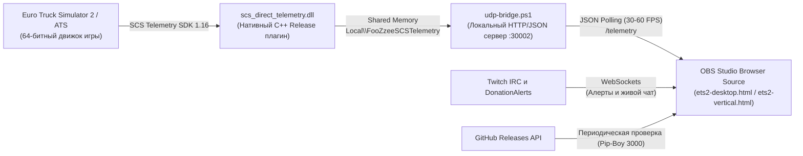

# 🚛 Cockpit Telemetry Stream Overlay для ETS2 и ATS

> **Профессиональный приборный HUD-оверлей для OBS Studio на базе нативного SCS Telemetry SDK 1.16**

[](https://github.com/FooZzee/ets2-ats-stream-overlay/releases)
[](https://www.microsoft.com/windows)
[](https://modding.scssoft.com/wiki/Documentation/Tools/Telemetry_server)
[](https://scssoft.com/)
[](https://obsproject.com/)
[](./LICENSE)

---

> **Навигация:** [English](./README.en.md) | **Русский** | [Общий README](./README.md) | [История изменений (Changelog)](./CHANGELOG.md)

---

## 📌 Оглавление

1. [Обзор и преимущества](#-обзор-и-преимущества)
2. [Нововведения версии 1.1.1](#-нововведения-версии-111)
3. [Архитектура и компоненты](#-архитектура-и-компоненты)
4. [Интерфейс сцен и расположение](#-интерфейс-сцен-и-расположение)
5. [Системные требования](#-системные-требования)
6. [Быстрая установка (1-клик установщик)](#-быстрая-установка-1-клик-установщик)
7. [Ручная настройка и параметры](#-ручная-настройка-и-параметры)
8. [Настройка сцены в OBS Studio](#-настройка-сцены-в-obs-studio)
9. [Диагностика и устранение неполадок](#-диагностика-и-устранение-неполадок)
10. [Автор и сообщество](#-автор-и-сообщество)

---

## 💎 Обзор и преимущества

**ETS2 / ATS Cockpit Telemetry Stream Overlay** — это высокопроизводительный приборный комплекс для стримеров Euro Truck Simulator 2 и American Truck Simulator. Оверлей разработан с акцентом на реалистичность, отсутствие визуального мусора в лобовом стекле и нулевую задержку передачи телеметрии.

* ⚡ **Прямой доступ к памяти (Shared Memory):** Скомпилированный C++ плагин (`scs_direct_telemetry.dll`) считывает телеметрию симулятора напрямую через SCS Telemetry SDK 1.16 без сторонних утилит, серверов node.js или эмуляторов.
* 🖥️ **Двухрядная приборная панель («Торпеда»):** Расположена в нижней части экрана (`1920×1080`), оставляя зеркала, навигатор F2 и лобовое стекло на 100% свободными.
* 📱 **Адаптация под вертикальные стримы:** Отдельная сцена (`1080×1920`) для TikTok Live, YouTube Shorts и Reels с учётом зон перекрытия интерфейсом соцсетей.
* ⏱️ **Расчёт реального времени прибытия (Real ETA):** Динамически конвертирует игровое навигационное время симулятора с учётом масштаба карты (`1:19` трасса, `1:3` город, `1:10` Великобритания) в реальные часы и минуты до конца рейса.
* 💬 **Интерактив со зрителями:** Встроенный чат Twitch IRC и анимированные FIFO-оповещения (`donate`, `sub`, `follow`, `raid`) с поддержкой DonationAlerts.
* 🌐 **Полная двуязычность:** Мгновенное переключение всего интерфейса между русским и английским языками (`RU` / `EN`).

---

## 🚀 Нововведения версии 1.1.1

> [!IMPORTANT]
> **Релиз v1.1.1** добавляет автономный терминал проверки обновлений с GitHub в ретро-стиле Pip-Boy 3000 (Fallout) с синтезом звуков CRT и печатной машинки, кнопку поддержки автора в графическом установщике и обновлённые инструкции для OBS Studio.

* 📟 **Автономный терминал обновлений Pip-Boy 3000:**
  * Фоновая проверка новых релизов через официальный GitHub API (`releases/latest`) без прерывания стрима.
  * Аутентичный ретро-дизайн кинескопа: зелёный люминофор (`#00ff66`), горизонтальные скан-линии (scanlines), виньетирование стеклянной колбы и кинематографичная анимация схлопывания луча CRT.
  * Встроенный WebAudio ретро-синтезатор: процедурная генерация звука щелчков клавиш печатной машинки и высоковольтного спадающего звука выключения кинескопа.
  * Интерактивные кнопки управления: **`[ 🚀 ОБНОВИТЬ ]`** (открывает страницу релиза на GitHub в браузере) и **`[ 💤 ДА НУ ЕГО НАФИГ ]`** (красиво гасит экран с отметкой об отклонении до следующего обновления).
  * Умный двуязычный парсинг описания релиза из GitHub: автоматическое извлечение описания на языке пользователя с очисткой Markdown-разметки.
  * Клик в область текста терминала мгновенно завершает посимвольную печать.
  * Демо-режим для стримеров: вызов через параметр `?test_update=1` в URL источника OBS или через консоль `window.showPipBoyUpdateModal()`.
* 💖 **Кнопка «ПОДДЕРЖАТЬ ПРОЕКТ» в установщике:**
  * В нижнюю панель установщика `Install-Overlay.bat` (`scripts/installer.ps1`) добавлена кнопка **«💖 ПОДДЕРЖАТЬ ПРОЕКТ»** / **«💖 SUPPORT PROJECT»**, открывающая страницу DonationAlerts автора: `https://www.donationalerts.com/r/foozzee`.
* 🚌 **Полная интеграция Euro Truck Simulator 2 — DLC Coaches:**
  * Нативное распознавание автобусных рейсов (`bus_job`) с сохранением 100% совместимости со стандартными грузоперевозками в ETS2 и ATS.
  * Чтение названий остановок отправления и назначения (`source_stop.*` ➔ `destination_stop.*`).
  * Вывод показателя удовлетворённости пассажиров в реальном времени: **`КОМФОРТ: XX%`** в бегущей строке бортового компьютера.
* ⚡ **Новые нативные каналы телеметрии:**
  * `bus_job.average_satisfaction` (`FLOAT`) — текущий комфорт пассажиров.
  * `rest.stop` (`S32`) — таймер времени до обязательного отдыха водителя в минутах.
  * `truck.electric.enabled` (`BOOL`) — статус бортовой электросети и зажигания.
  * `truck.engine.enabled` (`BOOL`) — статус работы двигателя.
* 🎛️ **100% сплошная непрозрачность торпеды:**
  * Фон нижней приборной панели в `ets2-desktop.html` сделан полностью непрозрачным (`alpha = 1`). Дорога, разметка и фары больше не просвечивают сквозь приборы в OBS Studio.
* 💳 **Настройка DonationAlerts в визарде:**
  * Поле ввода секретного токена с маскированием пароля и кнопкой **Показать / Скрыть** в `Install-Overlay.bat`.

---

## 🏛️ Архитектура и компоненты



| Компонент | Назначение | Стек технологий |
|---|---|---|
| `scs_direct_telemetry.dll` | Перехват и сериализация телеметрии симулятора | C++20, SCS Telemetry SDK 1.16, Win32 Shared Memory |
| `scripts/udp-bridge.ps1` | Высокоскоростной локальный HTTP-мост (`:30002`) | PowerShell 5.1+, `HttpListener`, JSON |
| `assets/js/ets2-updater.js` | Автономный терминал обновлений Pip-Boy 3000 | ES6 JavaScript, WebAudio API, GitHub REST API |
| `assets/css/ets2-pipboy.css` | Люминофорное свечение, скан-линии и CRT-анимации | Pure CSS3, Keyframe Animations, Flexbox |
| `ets2-desktop.html` | 2-рядный приборный комплекс Desktop (`1920×1080`) | HTML5, CSS Grid, Canvas, Vanilla JS |
| `ets2-vertical.html` | Вертикальная мобильная сцена (`1080×1920`) | HTML5, Mobile UI Safe Zones, CSS3 |
| `scripts/installer.ps1` | 1-клик графический установщик (`Install-Overlay.bat`) | PowerShell WinForms, UTF-8 с BOM |

---

## 💻 Системные требования

* **Операционная система:** Windows 10 / Windows 11 (64-бит).
* **Среда выполнения:** PowerShell 5.1+ (встроена в Windows по умолчанию).
* **Симулятор:** Euro Truck Simulator 2 (64-бит) и/или American Truck Simulator (64-бит).
* **ПО для стриминга:** OBS Studio 28.0+ (*Browser Source*).

---

## ⚡ Быстрая установка (1-клик установщик)

1. Скачайте архив релиза **`ETS2-ATS-Stream-Overlay-v1.1.1.zip`** из раздела [Releases](https://github.com/FooZzee/ets2-ats-stream-overlay/releases).
2. Распакуйте архив в постоянную папку (например, `C:\ETS2-ATS-Stream-Overlay`).
3. Запустите файл **`Install-Overlay.bat`**:
   * В правом верхнем углу выберите язык: **`Русский (RU)`** или **`English (EN)`**.
   * Установщик автоматически найдёт папки установленных в Steam симуляторов.
   * Введите **Никнейм водителя**, **Twitch-канал** и (по желанию) секретный **токен DonationAlerts**.
   * Нажмите **`Установить`**.
4. Установщик скопирует `scs_direct_telemetry.dll` в папки `bin\win_x64\plugins` обеих игр, создаст `config.js` и выведет ярлык **`ETS2-ATS Overlay Bridge`** на Рабочий стол.
   * Вы можете поддержать автора проекта по кнопке **«💖 ПОДДЕРЖАТЬ ПРОЕКТ»** в нижней панели установщика.

---

## ⚙️ Ручная настройка и параметры

При необходимости ручной настройки:

1. Скопируйте `config.example.js` в `config.js`.
2. Скопируйте `./redist/scs_direct_telemetry.dll` в:
   * `.../Euro Truck Simulator 2/bin/win_x64/plugins/scs_direct_telemetry.dll`
   * `.../American Truck Simulator/bin/win_x64/plugins/scs_direct_telemetry.dll`
3. Отредактируйте `config.js`:

```javascript
window.OVERLAY_CONFIG = {
  lang: 'ru', // 'ru' или 'en'
  ets2: {
    driverName: 'STREAMER',
    speedUnit: 'kmh'
  },
  channels: {
    twitch: {
      enabled: true,
      channelName: 'ваш_twitch_канал'
    },
    donationAlerts: {
      enabled: true,
      socketToken: 'ВАШ_СЕКРЕТНЫЙ_ТОКЕН' // из Настройки DonationAlerts -> Секретный токен
    }
  },
  theme: {
    cockpitPreset: 'amber' // 'amber' или 'ice'
  }
};
```

### Параметры URL для источника OBS Studio:
* `?lang=ru` или `?lang=en` — принудительный выбор языка для конкретной сцены.
* `?theme=ice` или `?theme=amber` — переключение цветовой схемы панели.
* `?cam=0` — скрыть рамку веб-камеры.
* `?test=1` — режим интерактивной демонстрации с анимацией датчиков и чатом.
* `?test_update=1` — вызов окна проверки обновлений Pip-Boy 3000.
* `?guides=1` — отображение линий разметки и безопасных зон.

---

## 🎥 Настройка сцены в OBS Studio

1. **Запуск моста телеметрии:** Запустите ярлык на Рабочем столе **`ETS2-ATS Overlay Bridge`** (`start-telemetry.bat`). Откроется консольное окно, транслирующее данные на `http://127.0.0.1:30002/telemetry`.
2. **Добавление оверлея (ОБЯЗАТЕЛЬНО СНИМИТЕ «ЛОКАЛЬНЫЙ ФАЙЛ»):**
   * В OBS в списке «Источники» нажмите **`+`** и выберите **«Браузер» (Browser Source)**.
   * > [!WARNING]
     > **КРИТИЧЕСКИ ВАЖНО:** **СНИМИТЕ галочку «Локальный файл»!**  
     > Оверлей необходимо добавлять исключительно через строку **«Ссылка» (URL)**. Если оставить галочку «Локальный файл», OBS изолирует страницу в строгой локальной песочнице: **интерактивные кнопки торпеды, окно Pip-Boy и внешние ссылки работать НЕ БУДУТ**.
   * В строку **«Ссылка» (URL)** вставьте полный путь к файлу оверлея:  
     `D:\html\Overlay\ets2-desktop.html` *(или `C:\ETS2-ATS-Stream-Overlay\ets2-desktop.html`)*  
     *(для вертикальной мобильной сцены: путь к `ets2-vertical.html`)*.
   * **Разрешение:** Ширина **`1920`**, Высота **`1080`** *(для вертикальной: **`1080`** × **`1920`**)*.
   * Отметьте пункты: **«Обновлять браузер, когда сцена становится активной»** и **«Закрывать источник, когда он невидим»**.
   * **Взаимодействие с кнопками:** Чтобы нажимать на кнопки оверлея (например, кнопки обновления Pip-Boy или ссылки соцсетей), нажмите правой кнопкой мыши по источнику браузера в OBS и выберите **«Взаимодействовать» (Interact)**.
3. **Размещение веб-камеры (Сцена Desktop):**
   * Размеры: Ширина **`346 px`**, Высота **`195 px`** (соотношение `16:9`).
   * Координаты: X (Слева) = **`24 px`**, Y (Сверху) = **`180 px`**.
   * В списке источников OBS поместите захват вашей веб-камеры **ниже** слоя Браузера, чтобы приборные уголки аккуратно легли поверх видеопотока.

---

## 🛠️ Диагностика и устранение неполадок

| Признак | Причина | Решение |
|---|---|---|
| Спидометр показывает `--` и `STANDBY` | Мост не запущен или плагин не установлен | Запустите `start-telemetry.bat`. Проверьте наличие `scs_direct_telemetry.dll` в `bin\win_x64\plugins\`. Откройте `http://127.0.0.1:30002/health` в браузере. |
| Игра запущена, но данные не обновляются | Запущена 32-битная версия или отклонён доступ к SDK | Запускайте 64-битную версию игры. При первом запуске нажмите «Да» во внутриигровом запросе на доступ SDK. До загрузки профиля в главное меню телеметрия ожидает в режиме ожидания. |
| "Port 30002 already in use" | Запущена повторная копия моста | Закройте дублирующие окна командной строки, в которых работает `start-telemetry.bat`. |
| Не приходят донат-оповещения | Неверный токен DonationAlerts | Проверьте поле `socketToken` в `config.js` (скопируйте секретный токен из раздела *Настройки аккаунта -> Секретный токен*, а не ссылку виджета). |
| Не работает чат Twitch | Неправильно указано имя канала | Убедитесь, что в параметре `channelName` указан только ваш логин Twitch (например, `'foozzee'`), без ссылок и символа `@`. |

---

## 👤 Автор и сообщество

* **Автор проекта:** FooZzee
* **Официальный сайт:** [foozzee.ru](https://foozzee.ru/)
* **Twitch:** [twitch.tv/foozzee](https://www.twitch.tv/foozzee)
* **YouTube:** [@foozzee](https://www.youtube.com/@foozzee)
* **Telegram:** [@foozzeestream](https://t.me/foozzeestream)
* **VK:** [vk.ru/gtfun](https://vk.ru/gtfun)

Лицензия: [MIT License](./LICENSE). Полная свобода использования для стримеров и создателей контента.
