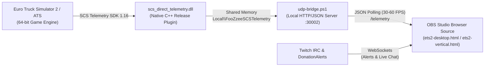

# 🚛 Cockpit Telemetry Stream Overlay для ETS2 и ATS

> **Профессиональный приборный HUD-оверлей для OBS Studio на базе нативного SCS Telemetry SDK 1.16**

[](https://github.com/FooZzee/ets2-ats-stream-overlay/releases)
[](https://www.microsoft.com/windows)
[](https://modding.scssoft.com/wiki/Documentation/Tools/Telemetry_server)
[](https://scssoft.com/)
[](https://obsproject.com/)
[](./LICENSE)

---

> **Навигация:** [English](./README.en.md) | **Русский** | [Общий README](./README.md) | [История изменений (Changelog)](./CHANGELOG.md)

---

## 📌 Оглавление

1. [Обзор и преимущества](#-обзор-и-преимущества)
2. [Нововведения версии 1.1.0](#-нововведения-версии-110)
3. [Архитектура и компоненты](#-архитектура-и-компоненты)
4. [Интерфейс сцен и расположение](#-интерфейс-сцен-и-расположение)
5. [Системные требования](#-системные-требования)
6. [Быстрая установка (1-клик установщик)](#-быстрая-установка-1-клик-установщик)
7. [Ручная настройка и параметры](#-ручная-настройка-и-параметры)
8. [Настройка сцены в OBS Studio](#-настройка-сцены-в-obs-studio)
9. [Диагностика и устранение неполадок](#-диагностика-и-устранение-неполадок)
10. [Автор и сообщество](#-автор-и-сообщество)

---

## 💎 Обзор и преимущества

**ETS2 / ATS Cockpit Telemetry Stream Overlay** — это высокопроизводительный приборный комплекс для стримеров Euro Truck Simulator 2 и American Truck Simulator. Оверлей разработан с акцентом на реалистичность, отсутствие визуального мусора в лобовом стекле и нулевую задержку передачи телеметрии.

* ⚡ **Прямой доступ к памяти (Shared Memory):** Скомпилированный C++ плагин (`scs_direct_telemetry.dll`) считывает телеметрию симулятора напрямую через SCS Telemetry SDK 1.16 без сторонних утилит, серверов node.js или эмуляторов.
* 🖥️ **Двухрядная приборная панель («Торпеда»):** Расположена в нижней части экрана (`1920×1080`), оставляя зеркала, навигатор F2 и лобовое стекло на 100% свободными.
* 📱 **Адаптация под вертикальные стримы:** Отдельная сцена (`1080×1920`) для TikTok Live, YouTube Shorts и Reels с учётом зон перекрытия интерфейсом соцсетей.
* ⏱️ **Расчёт реального времени прибытия (Real ETA):** Динамически конвертирует игровое навигационное время симулятора с учётом масштаба карты (`1:19` трасса, `1:3` город, `1:10` Великобритания) в реальные часы и минуты до конца рейса.
* 💬 **Интерактив со зрителями:** Встроенный чат Twitch IRC и анимированные FIFO-оповещения (`donate`, `sub`, `follow`, `raid`) с поддержкой DonationAlerts.
* 🌐 **Полная двуязычность:** Мгновенное переключение всего интерфейса между русским и английским языками (`RU` / `EN`).

---

## 🚀 Нововведения версии 1.1.0

> [!IMPORTANT]
> **Релиз v1.1.0** добавляет полноценную поддержку пассажирских перевозок и расширяет состав собираемых данных телеметрии.

* 🚌 **Полная интеграция Euro Truck Simulator 2 — DLC Coaches:**
  * Нативное распознавание автобусных рейсов (`bus_job`) с сохранением 100% совместимости со стандартными грузоперевозками в ETS2 и ATS.
  * Чтение названий остановок отправления и назначения (`source_stop.*` ➔ `destination_stop.*`).
  * Вывод показателя удовлетворённости пассажиров в реальном времени: **`КОМФОРТ: XX%`** в бегущей строке бортового компьютера.
* ⚡ **Новые нативные каналы телеметрии:**
  * `bus_job.average_satisfaction` (`FLOAT`) — текущий комфорт пассажиров.
  * `rest.stop` (`S32`) — таймер времени до обязательного отдыха водителя в минутах.
  * `truck.electric.enabled` (`BOOL`) — статус бортовой электросети и зажигания.
  * `truck.engine.enabled` (`BOOL`) — статус работы двигателя.
* 🎛️ **100% сплошная непрозрачность торпеды:**
  * Фон приборной панели в `ets2-desktop.html` выполнен со 100% непрозрачностью (`alpha = 1`). Дорожное полотно, фары и разметка больше не просвечивают сквозь спидометр и навигацию в OBS Studio.
* 💳 **Мастер настройки DonationAlerts:**
  * В графический установщик добавлено защищённое поле ввода токена DonationAlerts с возможностью скрыть/показать секрет.

---

## 🏛️ Архитектура и компоненты



| Компонент | Назначение | Технологии |
|---|---|---|
| `scs_direct_telemetry.dll` | Нативный перехватчик телеметрии в процессе игры | C++20, SCS Telemetry SDK 1.16, Win32 Shared Memory |
| `scripts/udp-bridge.ps1` | Высокоскоростной локальный HTTP-мост (`:30002`) | PowerShell 5.1+, `HttpListener`, JSON |
| `scripts/installer.ps1` | Графический 1-клик установщик | Windows Forms / WPF, Registry Auto-Detection |
| `ets2-desktop.html` | Горизонтальный HUD для OBS (`1920×1080`) | HTML5, CSS Grid/Flexbox, Vanilla JS, WebAudio |
| `ets2-vertical.html` | Вертикальный HUD для OBS (`1080×1920`) | Safe-Zone Layout, Responsive CSS |

---

## 🎛️ Интерфейс сцен и расположение

### Горизонтальная сцена (`1920×1080` — `ets2-desktop.html`)

```text
+-----------------------------------------------------------------------------------+
| [ real-eta-panel ]                                                                 |
|   РЕАЛЬНОЕ ВРЕМЯ ДО ЦЕЛИ                                                           |
|                                                                                   |
| +----------------+                                                                |
| |  WEBCAM FRAME  |                                                                |
| |  (346 x 195)   |                                                                |
| +----------------+                                                                |
|                                                     +---------------------------+ |
|                                                     | FIFO ALERTS / CHAT        | |
|                                                     | (Sub, Donate, Follow)     | |
|                                                     +---------------------------+ |
| ================================================================================= |
| РЯД 1: [СПИДОМЕТР] [КРУИЗ] [КПП] [ТАХОМЕТР] [ГАЗ/ТОРМ/РУЛЬ] [ИНДИКАТОРЫ] [МАРШРУТ] |
| РЯД 2: [ТЯГАЧ/АВТОБУС] [ОДОМЕТР] [ИЗНОС] [7 ДАТЧИКОВ БК] [БЕГУЩАЯ СТРОКА] [TWITCH] |
+-----------------------------------------------------------------------------------+
```

* **Ряд 1 (Движение и навигация):**
  * Спидометр (`КМ/Ч`), индикатор круиз-контроля (`CC`), передача КПП, тахометр (`RPM`), шкалы физических нажатий педалей и поворота руля (**ГАЗ / ТОРМ / РУЛЬ**).
  * Полный блок контрольных ламп: поворотники, аварийка, габариты, ближний/дальний свет, маяк, дворники, ручник, ретардер/горный тормоз, блокировка дифференциала, подъёмные оси, предупреждения (топливо, воздух, масло, перегрев, АКБ) и дорожный знак ограничения скорости.
  * Прогресс-бар маршрута, города отправления и прибытия, масса груза или число пассажиров.
* **Ряд 2 (Бортовой компьютер и экономика):**
  * Марка, модель и госномер машины, одометр, статус целостности тягача, прицепа и груза.
  * **7 аналогово-цифровых датчиков в одну линию:** Остаток топлива, запас хода (км), текущий расход (л/100км), температура масла/воды, давление в пневмосистеме, остаток AdBlue, напряжение АКБ.
  * **Бегущая строка рейса:** Оплата за доставку, компании, тип контракта, уровень комфорта пассажиров, пройдено за рейс, расход за поездку, максимальная скорость.

---

## 💻 Системные требования

* **ОС:** Windows 10 / Windows 11 (64-бит).
* **Среда выполнения:** PowerShell 5.1+ (встроена в Windows по умолчанию).
* **Симулятор:** Euro Truck Simulator 2 (64-бит) и/или American Truck Simulator (64-бит).
* **ПО для стриминга:** OBS Studio 28.0+ (источник *Browser Source*).

---

## ⚡ Быстрая установка (1-клик установщик)

1. Скачайте свежий релизный архив **`ETS2-ATS-Stream-Overlay-v1.1.0.zip`** из вкладки [Releases](https://github.com/FooZzee/ets2-ats-stream-overlay/releases).
2. Распакуйте архив в любую постоянную папку (например, `C:\ETS2-ATS-Stream-Overlay`).
3. Запустите файл **`Install-Overlay.bat`**:
   * В правом верхнем углу выберите язык: **`English (EN)`** или **`Русский (RU)`**.
   * Установщик автоматически определит установленные игры через библиотеки Steam.
   * Укажите ваш **Никнейм стримера**, **Канал Twitch** и при желании секретный **Токен DonationAlerts**.
   * Нажмите **`Установить`**.
4. Плагин `scs_direct_telemetry.dll` будет скопирован в папки `bin\win_x64\plugins` выбранных игр, сгенерируется готовый `config.js` и создастся ярлык на Рабочем столе: **`ETS2-ATS Overlay Bridge`**.

---

## ⚙️ Ручная настройка и параметры

Если вы предпочитаете настраивать проект вручную:

1. Скопируйте `config.example.js` в `config.js`.
2. Скопируйте `./redist/scs_direct_telemetry.dll` в:
   * `.../Euro Truck Simulator 2/bin/win_x64/plugins/scs_direct_telemetry.dll`
   * `.../American Truck Simulator/bin/win_x64/plugins/scs_direct_telemetry.dll`
3. Настройте параметры в `config.js`:

```javascript
window.OVERLAY_CONFIG = {
  lang: 'ru', // 'ru' или 'en'
  ets2: {
    driverName: 'FOOZZEE',
    speedUnit: 'kmh'
  },
  channels: {
    twitch: {
      enabled: true,
      channelName: 'your_twitch_channel'
    },
    donationAlerts: {
      enabled: true,
      socketToken: 'ВАШ_СЕКРЕТНЫЙ_ТОКЕН' // из настроек аккаунта DonationAlerts
    }
  },
  theme: {
    cockpitPreset: 'amber' // 'amber' (янтарный) или 'ice' (ледяной)
  }
};
```

### URL-модификаторы для источников OBS:
* `?lang=ru` или `?lang=en` — принудительный язык оверлея.
* `?theme=ice` или `?theme=amber` — переключение цветовой схемы приборной панели.
* `?cam=0` — скрыть рамку веб-камеры.
* `?test=1` — режим демонстрации с тестовой анимацией приборов, чата и алертов.
* `?guides=1` — отображение линий безопасных зон и сетки привязки.

---

## 🎥 Настройка сцены в OBS Studio

1. **Запуск телеметрии:** Запустите ярлык **`ETS2-ATS Overlay Bridge`** (`start-telemetry.bat`). В открывшейся консоли запустится локальный сервер на порту `30002`.
2. **Добавление оверлея в OBS:**
   * Источник: **Браузер (Browser Source)**.
   * Локальный файл: выберите `ets2-desktop.html` (или `ets2-vertical.html` для мобильного стрима).
   * Разрешение: **`1920 × 1080`** (для вертикального: **`1080 × 1920`**).
   * Отметьте галочки: *«Обновлять браузер, когда сцена становится активной»*.
3. **Настройка рамки веб-камеры (для Desktop-сцены):**
   * Ширина: **`346 px`**, Высота: **`195 px`** (соотношение `16:9`).
   * Положение: X (слева) = **`24 px`**, Y (сверху) = **`180 px`**.
   * В списке источников OBS разместите слой вашей веб-камеры **ниже** слоя браузерного оверлея, чтобы угловые декоративные скобки обрамляли камеру.

---

## 🛠️ Диагностика и устранение неполадок

| Признак | Причина | Способ решения |
|---|---|---|
| Спидометр показывает `--` и горит `STANDBY` | Мост телеметрии не запущен или плагин не установлен | Запустите `start-telemetry.bat`. Проверьте наличие `scs_direct_telemetry.dll` в папке игры `bin\win_x64\plugins\`. Проверьте статус моста по адресу `http://127.0.0.1:30002/health`. |
| Игра запущена, но данные не обновляются | Запуск 32-битной игры или отказ от SDK | Запускайте 64-битную версию игры. При первом старте обязательно подтвердите системный запрос симулятора на использование SDK. |
| Ошибка «Порт 30002 занят» | Дубликат процесса моста | Закройте второе запущенное окно `start-telemetry.bat` через Диспетчер задач или панель задач. |
| Не приходят донат-оповещения | Неверный токен DonationAlerts | Проверьте `socketToken` в `config.js` (токен берётся в разделе *Настройки аккаунта -> Секретный токен*, а не код виджета). |
| Отсутствует чат Twitch | Некорректно указано имя канала | В `config.js` в поле `channelName` указывайте только имя пользователя (например, `'foozzee'`), без ссылок и символа `@`. |

---

## 👤 Автор и сообщество

* **Автор проекта:** FooZzee
* **Официальный сайт:** [foozzee.ru](https://foozzee.ru/)
* **Twitch:** [twitch.tv/foozzee](https://www.twitch.tv/foozzee)
* **YouTube:** [@foozzee](https://www.youtube.com/@foozzee)
* **Telegram:** [@foozzeestream](https://t.me/foozzeestream)
* **VK:** [vk.ru/gtfun](https://vk.ru/gtfun)

Лицензия проекта — [MIT License](./LICENSE). Свободно для использования, модификации и проведения стримов.
